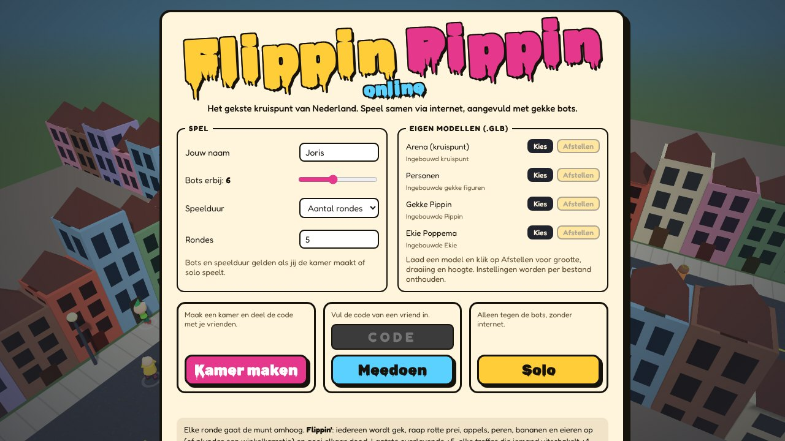
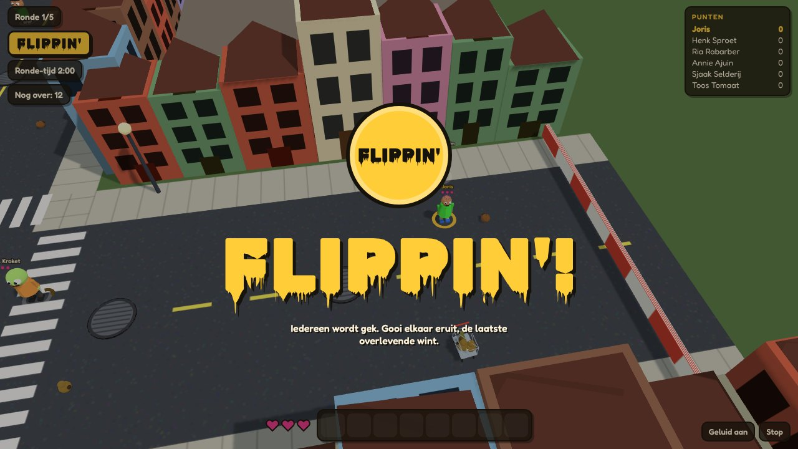
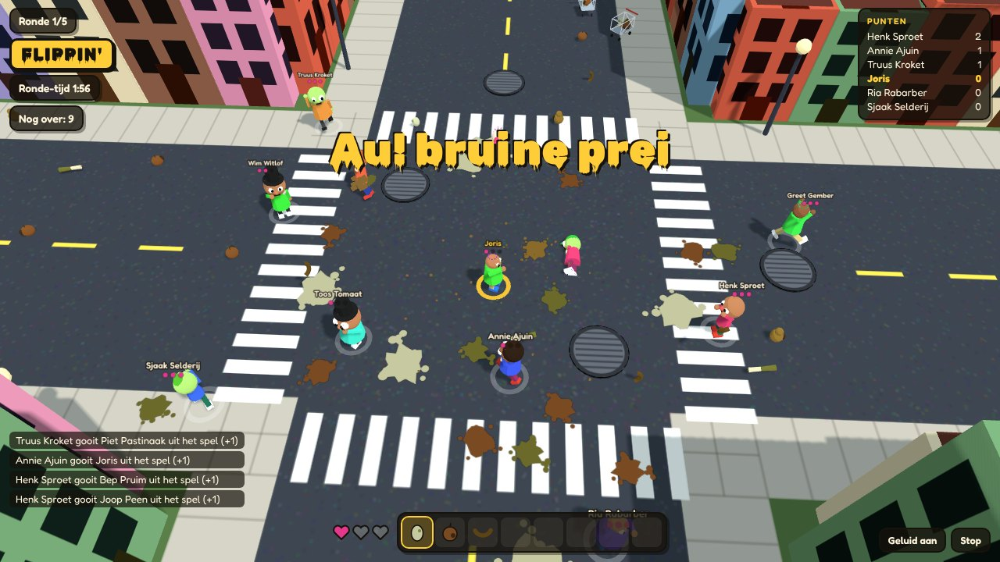
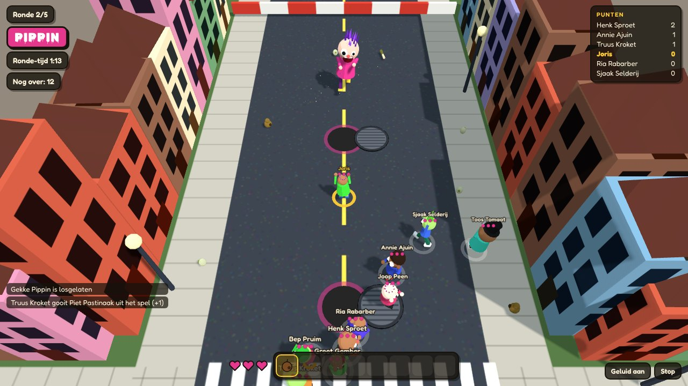
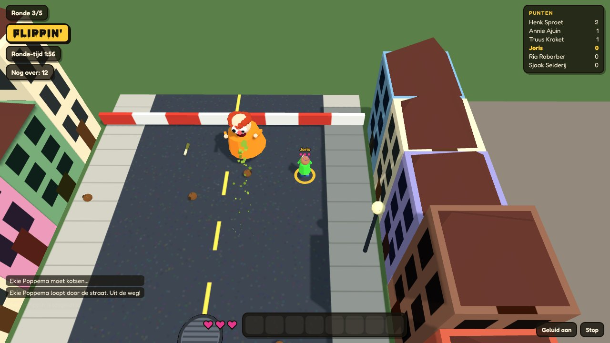
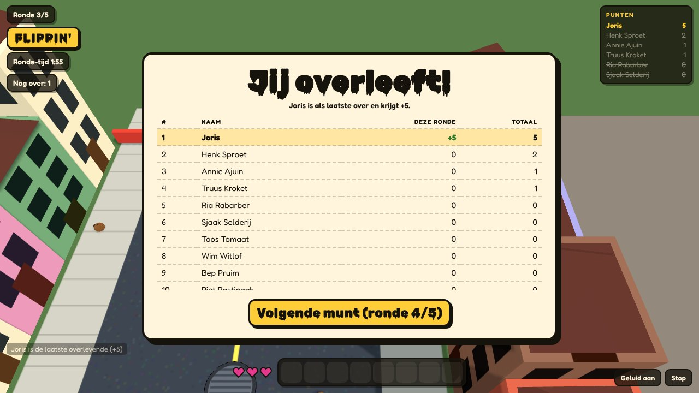
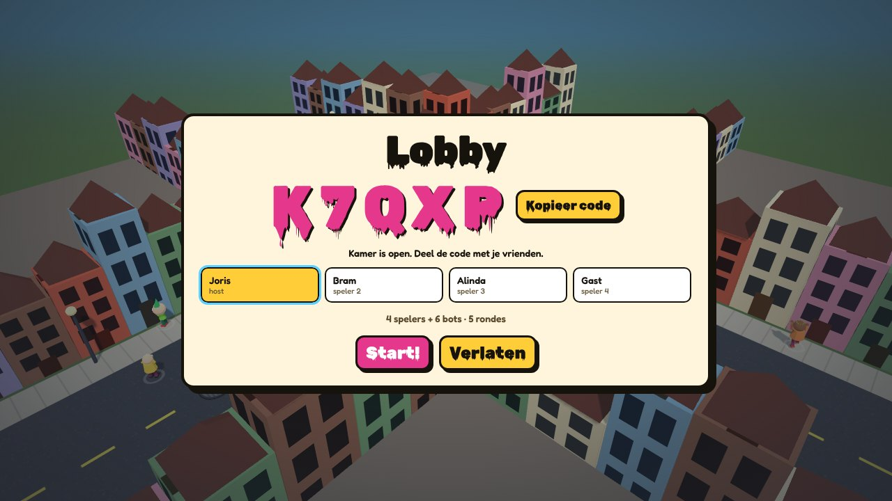
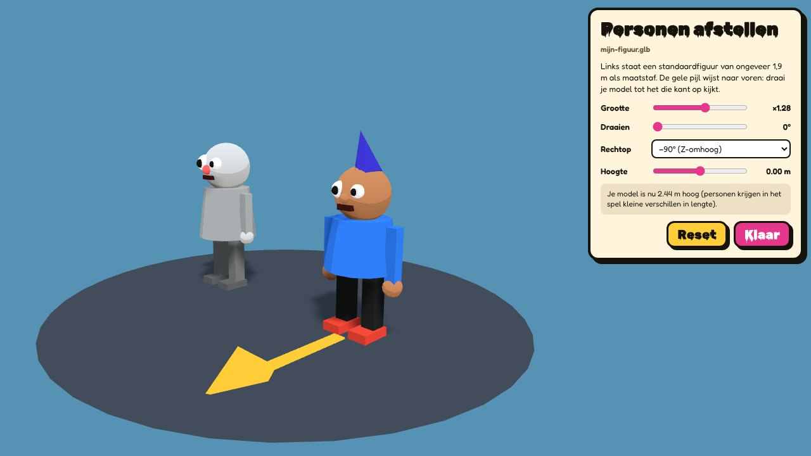
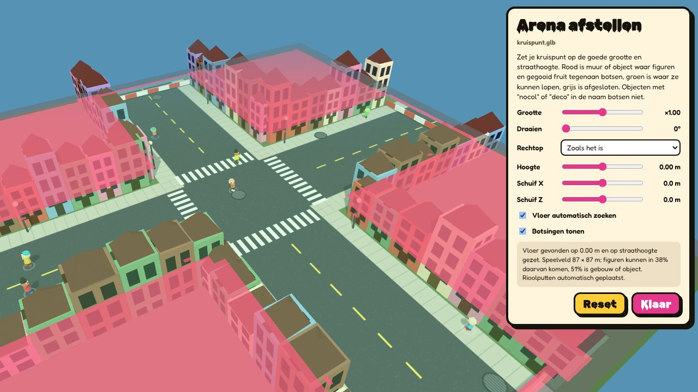

# Flippin Pippin

**Het gekste kruispunt van Nederland.** Een 3D-partyspel in de browser met gekke figuren. Elke ronde gaat er een munt omhoog. Valt hij op **Flippin'**, dan gooit iedereen elkaar dood met rot fruit. Valt hij op **Pippin**, dan komt gekke Pippin mensen opeten en moet je haar een rioolput in lokken. En af en toe sjokt Ekie Poppema door de straat, die alles opeet wat ze tegenkomt.

### ▶ [Speel nu: endless1977.github.io/FlippinPippin](https://endless1977.github.io/FlippinPippin/)

Je hoeft niets te installeren: het spel is één HTML-bestand. Speel solo tegen bots, of samen via internet met een kamercode.

---

## Zo werkt een ronde

Elke ronde begint met een muntworp, gevolgd door 3, 2, 1, GO.

### Flippin'
Iedereen wordt gek en rent door elkaar. Raap rotte dingen op door eroverheen te lopen, en gooi ermee:

| Item | Effect |
|---|---|
| Bruine appel, bruine peer | 1 schade |
| Bruine banaan | 1 schade, laat een schil achter waarop mensen (en Pippin) uitglijden |
| Bruine prei | 2 schade |
| Rot ei | Spat open en raakt iedereen in de buurt |
| Winkelkarretje | Rolt rond; loop ertegenaan voor 4 items tegelijk |

Iedereen heeft 3 levens. De laatste overlevende krijgt **+5**, elke uitschakeling **+1**. Na 2 minuten krijgt iedereen die nog staat +2.

### Pippin
De putdeksels schuiven open en **gekke Pippin** komt je opeten. Dood krijg je haar niet, maar je kunt haar wel afweren met dezelfde rotte spullen. Raak je haar, dan stormt ze in een rechte lijn op je af. Sta je achter een open rioolput, dan valt ze erin en is de ronde voorbij.

- Alle overlevenden krijgen **+3**, en wie haar erin lokte nog eens **+3**.
- Houdt iedereen het 75 seconden vol, dan geeft Pippin het op en krijgt iedereen die nog leeft +1.

### Ekie Poppema
Af en toe komt **Ekie Poppema** langs. Eerst verschijnt er een waarschuwing en een stippellijn over haar route. Daarna loopt ze recht door de straat en eet alles op: fruit, karretjes, bananenschillen, en ook mensen. Na elke 5 rotte dingen moet ze kotsen. In die groene plas loop je een stuk trager.

### Winnen
Na elke ronde zie je het scorebord. Wie de meeste punten heeft na het ingestelde aantal rondes of minuten, wint het potje.

---

## Besturing

| | Toetsenbord en muis | Touchscreen |
|---|---|---|
| Lopen | `WASD` of pijltjes | Linkerhelft van het scherm (joystick) |
| Mikken | Muis | Automatisch op de dichtstbijzijnde |
| Gooien | Klik of `spatie` | Knop **GOOI** |
| Oprapen | Gaat vanzelf | Gaat vanzelf |

---

## Samen spelen via internet

1. Iedereen opent het spel via de link hierboven.
2. Eén speler klikt **Kamer maken** en krijgt een code van 5 tekens.
3. De anderen vullen die code in en klikken **Meedoen**.
4. De host klikt **Start!**

- Maximaal 8 echte spelers per kamer. Bots vullen de rest aan (0 tot 14, in te stellen door de host).
- De host is de scheidsrechter: zijn computer rekent het spel door. Houd het tabblad van de host dus open.
- Valt iemand halverwege weg, dan neemt een bot zijn poppetje over.
- Spelers vinden elkaar via de gratis PeerJS-server en verbinden daarna rechtstreeks. Achter sommige strenge routers of mobiele netwerken lukt dat niet. Laat dan een andere speler hosten.
- **Solo** werkt zonder anderen: alleen jij tegen de bots.

---

## Eigen 3D-modellen (.glb)

In het menu kies je eigen GLB-bestanden voor de **arena**, de **personen**, **Pippin** en **Ekie**. Klik daarna op **Afstellen** om ze goed te zetten.

| Instelling | Wat het doet |
|---|---|
| Grootte | ×0,125 tot ×8 |
| Draaien | In stappen van 15° |
| Rechtop | Voor modellen die liggen of op hun kop staan (−90°, +90°, ondersteboven). Modellen uit Blender hebben vaak −90° nodig |
| Hoogte | Model omhoog of omlaag |
| Schuif X / Z | Alleen arena: de straat verschuiven |
| Vloer automatisch zoeken | Alleen arena: zoekt het straatniveau en zet dat op loophoogte |

Bij figuren staat een maatstaf naast je model, en een gele pijl wijst naar voren. De afstelling wordt per bestandsnaam onthouden in je browser.

### Botsingen in je arena
Alles in de arena tussen 35 cm en 2,2 m boven de straat is een muur, voor figuren, Pippin, karretjes en gegooid fruit. Dichte ruimtes waar niemand kan komen, zoals de binnenkant van huizen, tellen als massief. Met **Botsingen tonen** zie je het in kleur: rood is muur, groen is waar je kunt lopen, grijs is afgesloten.

*Op deze screenshot is het ingebouwde kruispunt als voorbeeld-arena geladen.*

Naamgeving van objecten in je model (bijvoorbeeld in Blender):

| Naam bevat | Gevolg |
|---|---|
| `nocol` of `deco` | Botst niet (handig voor bankjes, bloembakken, lantaarns) |
| `riool`, `manhole`, `putdeksel`, `sewer`, `drain` of `put_` | Wordt een rioolput voor Pippin. Zonder zulke objecten worden de putten automatisch geplaatst |

**Online:** de host stuurt zijn botsingen en arena-instellingen naar iedereen. Speelt de host op een eigen arena, dan vraagt de lobby de andere spelers om hetzelfde bestand te laden. Eigen figuren, Pippin en Ekie zie je alleen op je eigen scherm.

---

## Techniek

- Eén bestand: [`index.html`](index.html)
- 3D met [three.js](https://threejs.org/) r128, eigen modellen via GLTFLoader
- Multiplayer met [PeerJS](https://peerjs.com/) (WebRTC); de host stuurt 20 keer per seconde de spelstand
- Geluid wordt in de browser gemaakt met de Web Audio API, er zitten geen geluidsbestanden in
- Draait in Chrome, Edge en Firefox, op desktop en op tablet of telefoon

---

## Credits

Naar een idee van **Bram Zuijdervliet** en **Alinda Zuijdervliet**.
Designer: **Joris Zuijdervliet**.

*Opgedragen aan Esther. Veel speelplezier!*
